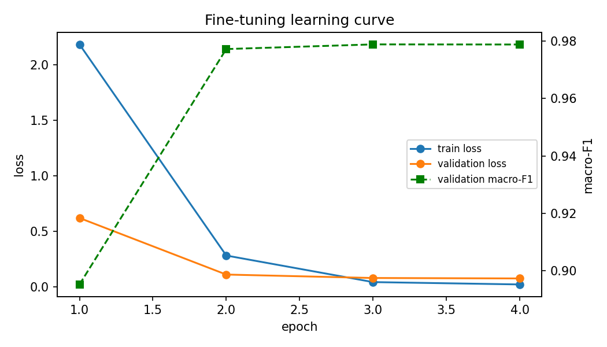

# Ticket Assistant: Bilingual Support-Ticket Triage (English, MSA, Gulf Arabic)

SDAIA Academy · Applied NLP Engineering · Capstone Project
**Author:** Badryah

## Problem

Customer-support teams receive tickets in English, Modern Standard Arabic (MSA) and Gulf dialect.
Our system takes a support ticket and produces its **intent** (27 classes), **priority**, **order ID**,
**similar past tickets**, and a **routing decision** (handle automatically or send to a human).

**Success metrics:** macro-F1 on intent, reported separately for English and Arabic, accuracy per
Arabic variety (MSA vs. Gulf), Hit@5 for similar-ticket search, and p95 latency per ticket.

**Key finding:** a model trained on English only understands MSA reasonably (75%) but struggles with
Gulf dialect (45%). Adding a small set of Arabic training tickets fixes MSA, and fine-tuning closes
most of the dialect gap (45% → 72%).

## Data

| Set | Source | Size | Use |
|---|---|---|---|
| English tickets | Bitext customer-support dataset (26,872 tickets, 27 intents) | 300 per intent after de-duplication → 5,670 train / 1,215 val / 1,215 test (stratified, seed 42) | train / val / test |
| Arabic train | Synthetic tickets created for this project, reviewed manually | 216 (81 MSA, 135 Gulf), 8 per intent → 162 train / 54 val (stratified) | train / val |
| Arabic test | Synthetic tickets created for this project, reviewed manually | 81 (28 MSA, 53 Gulf), 3 per intent | test only |
| Knowledge base | Fictional store policies (16 articles) | 16 | retrieval for grounded replies |

No Arabic test sentence appears in the Arabic training set.

**Limitations of the data:** the English data is template-based, so English scores are optimistic.
The Arabic test set is small (28 MSA, 53 Gulf), so one MSA ticket moves accuracy by about 3.6 points.

## Approach

```
Ticket ─► Embed (multilingual-e5-small) ─► Classify intent + confidence
                                         ─► Similar past tickets (top-3 search)
                                         ─► Policy retrieval (top-2 KB articles)
       ─► Regex: order ID     ─► Rule: priority (intent + urgency words)
       ─► Confidence below threshold? → route to human
       ─► Optional: LLM drafts a grounded reply with citations, validated with Pydantic
```

**Models compared (same test sets):**
1. TF-IDF + logistic regression, English training only (baseline)
2. e5 embeddings + logistic regression, English training only
3. TF-IDF + logistic regression, English + Arabic training
4. e5 embeddings + logistic regression, English + Arabic training
5. Fine-tuned DistilmBERT (`distilbert-base-multilingual-cased`), English + Arabic training

**Thresholds** are chosen on validation data only, one per language (English τ = 0.30, Arabic τ = 0.45),
as the lowest value that reaches 95% accuracy on accepted tickets.

## Results

### Main comparison

| Model | Macro-F1 EN | Macro-F1 AR | Acc. MSA | Acc. Gulf | p50 (ms) | p95 (ms) |
|---|---|---|---|---|---|---|
| 1. TF-IDF + LR (EN train) | 0.980 | 0.003 | 3.6% | 3.8% | 0.9 | 1.3 |
| 2. e5 + LR (EN train) | 0.995 | 0.540 | 75.0% | 45.3% | 11.5 | 14.4 |
| 3. TF-IDF + LR (EN + AR train) | 0.981 | 0.576 | 53.6% | 62.3% | 0.9 | 1.4 |
| 4. e5 + LR (EN + AR train) | 0.996 | 0.673 | **96.4%** | 52.8% | 11.4 | 16.3 |
| **5. Fine-tuned DistilmBERT (EN + AR train)** | **0.997** | **0.763** | 85.7% | **71.7%** | 5.3 | **7.0** |

Latency is per single ticket on a Colab T4 GPU. All models run locally, so there is no per-request API cost.

**Observations**
- The English-only baseline collapses on Arabic (F1 0.003): it relies on English words.
- e5 transfers across languages without any Arabic training (F1 0.54), but much better to MSA than Gulf.
- Adding 162 Arabic tickets lifts MSA from 75% to 96% with e5, but Gulf only from 45% to 53%.
- TF-IDF with Arabic data beats e5 on Gulf (62% vs. 53%): dialect words such as "أبي", "وش", "حقي" matter,
  and the embedding model does not capture them well. This motivated fine-tuning.
- Fine-tuning gives the best overall Arabic F1 and the best Gulf accuracy (72%), and is twice as fast as e5.
- **Trade-off:** e5 + Arabic data is better on MSA (96% vs. 86%, a difference of 3 tickets), while the
  fine-tuned model is better on Gulf (+10 tickets). We choose the fine-tuned model because Gulf dialect is
  the main problem we set out to solve and the larger share of real tickets.
- English performance did not drop when Arabic data was added.

### Leakage check

We embedded the Arabic test and training sets and flagged test tickets with cosine similarity > 0.95 to any
training ticket (10 of 81). Results on the remaining 71 tickets:

| Model | Macro-F1 AR | Acc. MSA | Acc. Gulf |
|---|---|---|---|
| 2. e5 + LR (EN train) | 0.482 | 72.7% | 42.9% |
| 4. e5 + LR (EN + AR train) | 0.614 | 95.5% | 51.0% |
| 5. Fine-tuned DistilmBERT | 0.725 | 81.8% | 71.4% |

The improvements hold. Manual review of the flagged pairs showed they are mostly different requests with
a similar style (some even have different intents), so the 0.95 threshold is conservative for e5.

### Abstention (routing to humans)

| | Threshold | Coverage (handled automatically) | Accuracy on handled tickets |
|---|---|---|---|
| English | 0.30 | 99.6% | 99.8% |
| Arabic | 0.45 | 23.5% | 100% |

The system is cautious on Arabic: it only auto-handles tickets it is confident about and sends the rest
to an agent, instead of guessing.

**Similar-ticket search:** Hit@5 = 0.998 on English (a ticket with the same intent appears in the top 5).

### Fine-tuning details

`distilbert-base-multilingual-cased`, learning rate 3e-5, 4 epochs, batch 32, 10% warmup, weight decay 0.01,
max length 48 tokens, fp16, early stopping (patience 2), best checkpoint selected by validation macro-F1.
Arabic training tickets oversampled ×10 (training set only). Training time: about 1.5 minutes on a T4.

| Epoch | Train loss | Val loss | Val macro-F1 |
|---|---|---|---|
| 1 | 2.183 | 0.618 | 0.895 |
| 2 | 0.280 | 0.108 | 0.977 |
| 3 | 0.040 | 0.077 | 0.979 |
| 4 | 0.019 | 0.073 | 0.979 |

Validation loss keeps decreasing and F1 plateaus, so there is no sign of overfitting.



## Error analysis

The fine-tuned model misclassified 19 of 81 Arabic test tickets. Ten representative errors:

| # | Ticket | Gold | Predicted | Cause |
|---|---|---|---|---|
| 1 | ممكن تكنسلون طلبي؟ غيرت رأيي | cancel_order | review | Missing coverage: anglicized verb "تكنسلون" rare in training |
| 2 | تقبلون مدى وأبل باي؟ | check_payment_methods | delivery_options | Missing coverage: brand names written in Arabic |
| 3 | خصموا مني مرتين على نفس الطلب، عاجل | payment_issue | change_order | Model error, high business cost (urgent payment problem misrouted) |
| 4 | تم خصم المبلغ مرتين من بطاقتي | payment_issue | get_refund | Genuinely ambiguous: double charge implies a refund request |
| 5 | كيف أنشئ حساباً جديداً في موقعكم؟ | create_account | delete_account | Model error: focused on "account", ignored the verb |
| 6 | كيف أضيف منتج ثاني لنفس الطلب؟ | change_order | set_up_shipping_address | Surface cue: "add … another" matches a training ticket about addresses |
| 7 | ما وصلني رابط تغيير كلمة السر | recover_password | change_shipping_address | Surface cue: "didn't arrive" associated with delivery |
| 8 | وين فلوسي؟ طلبت استرجاع من أسبوع | track_refund | check_refund_policy | Confusable labels: tracking a refund vs. refund policy |
| 9 | أريد مراجعة الفاتورة الخاصة بطلبي الأخير | check_invoice | get_invoice | Label boundary unclear: check vs. get invoice |
| 10 | رجعوا لي المبلغ لو سمحتوا ما أبي الطلب | get_refund | check_cancellation_fee | Genuinely ambiguous: could mean cancel or refund |

**Patterns**
- Confusable label pairs cause most errors: `track_refund` ↔ `check_refund_policy` (3 errors),
  `check_invoice` ↔ `get_invoice`, `payment_issue` ↔ `get_refund`.
- Both Arabic payment-issue tickets (double charges) were misclassified by both models. This is the most
  costly error type and the first thing to fix.
- The e5 + Arabic model is correct on 10 of the fine-tuned model's 19 errors, so the two models
  are complementary.

English errors (5 of 1,215) are mostly typos and ambiguous phrasing, e.g. "am I entitled to a
reimbursement?" (policy vs. refund request).

## How to run

Tested on Google Colab with a T4 GPU.

```bash
pip install -r requirements.txt
python assistant.py eval     # trains models 1-4, evaluates, writes results/
python finetune.py           # fine-tunes model 5 (GPU), adds it to results/comparison.csv
python assistant.py demo     # Gradio demo: before/after comparison + results chart
```

Optional LLM-drafted replies (any OpenAI-compatible endpoint):

```bash
export LLM_BASE_URL="https://.../v1"
export LLM_API_KEY="..."
export LLM_MODEL="..."
```

Without these variables the system still classifies, extracts and retrieves, and marks the reply as `needs_human`.

## Repository structure

```
assistant.py          # data, models 1-4, retrieval, routing, evaluation, demo
finetune.py           # fine-tuning of model 5
arabic_train.csv      # Arabic training tickets (text, intent, variety)
arabic_test.csv       # Arabic test tickets (test only)
requirements.txt
results/
  comparison.csv                     # main results table
  metrics.json                       # thresholds, coverage, leakage check
  learning_curve.png
  arabic_predictions.csv             # predictions of models 2 and 4
  arabic_predictions_finetuned.csv   # predictions of model 5
  near_duplicates.csv                # leakage check details
  errors_en.csv
```

## Limitations

- English data is template-based; English scores overstate real-world performance.
- The Arabic test set is small (81 tickets) and synthetic; results should be confirmed on real tickets.
- The demo's before/after view uses the e5 models (2 and 4); the fine-tuned model is evaluated offline
  and is not yet wired into the live `assist()` function.
- The knowledge base contains fictional policies.

## Next steps

1. Collect real Gulf-dialect tickets, especially for payment issues and the confusable label pairs.
2. Write clearer label definitions for confusable pairs (e.g. "track" = refers to an existing request).
3. Combine the fine-tuned model and e5 + LR (voting or cascade), since their errors differ.
4. Escalate any ticket with urgency or double-charge cues to a human, regardless of the predicted intent.
5. Use the fine-tuned model inside the live assistant and demo.
